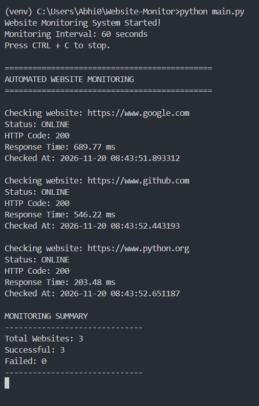

# Automated Website Monitoring System

A Python-based automated website monitoring system that periodically checks website availability, measures response times, detects HTTP errors, and maintains structured monitoring logs.

## Overview

The Automated Website Monitoring System is designed to monitor multiple websites without requiring continuous manual supervision.

It automatically sends HTTP requests to configured websites, evaluates their responses, records performance metrics, and handles network-related failures.

The system uses scheduled execution to perform monitoring checks at configurable intervals.

## Features

- **Automated Monitoring:** Periodically checks multiple websites.
- **Availability Detection:** Identifies successful responses and HTTP errors.
- **Response Time Measurement:** Measures website response times in milliseconds.
- **Error Handling:** Handles request timeouts, connection failures, and unexpected exceptions.
- **Structured Logging:** Records monitoring results with timestamps and severity levels.
- **Log Rotation:** Automatically rotates log files to prevent unlimited storage growth.
- **Monitoring Summary:** Displays successful and failed website checks after each cycle.
- **Graceful Shutdown:** Supports safe termination using `Ctrl + C`.
- **Centralized Configuration:** Manages monitored websites and monitoring settings from a single configuration file.

## Technology Stack

| Technology | Purpose |
|---|---|
| Python | Core programming language |
| Requests | HTTP requests and website connectivity |
| Schedule | Automated periodic execution |
| Logging | Monitoring records and error tracking |
| Git | Version control |
| GitHub | Source code hosting |

## Project Architecture

```text
                 START
                   |
                   v
             main.py
                   |
                   v
          Load config.py
                   |
                   v
         Read website URLs
                   |
                   v
          monitor.py
                   |
                   v
           Send HTTP Request
                   |
                   v
        Check HTTP Response
                   |
          +--------+--------+
          |                 |
          v                 v
      Successful          Failure
       Response          / Exception
          |                 |
          v                 v
     Record Status     Record Error
          |                 |
          +--------+--------+
                   |
                   v
           Update Summary
                   |
                   v
             Log Results
                   |
                   v
          Wait for Next Cycle
                   |
                   v
                REPEAT
```

## Project Structure

```text
Automated-Website-Monitor/
│
├── main.py             # Main automation and scheduler
├── monitor.py          # Website checking and error handling
├── config.py           # Website and monitoring configuration
├── requirements.txt    # Python dependencies
├── monitor.log         # Generated monitoring log
├── .gitignore          # Files excluded from Git
├── LICENSE             # Project license
└── README.md           # Project documentation
```

## Installation and Setup

### 1. Clone the repository

```bash
git clone https://github.com/YOUR-USERNAME/Automated-Website-Monitor.git
```

### 2. Navigate to the project directory

```bash
cd Automated-Website-Monitor
```

### 3. Create a virtual environment

```bash
python -m venv venv
```

### 4. Activate the virtual environment

For Windows:

```bash
venv\Scripts\activate
```

For macOS/Linux:

```bash
source venv/bin/activate
```

### 5. Install dependencies

```bash
pip install -r requirements.txt
```

## Configuration

Open `config.py` to configure the websites and monitoring parameters.

Example:

```python
WEBSITES = [
    "https://www.google.com",
    "https://www.github.com",
    "https://www.python.org"
]

CHECK_INTERVAL = 60

REQUEST_TIMEOUT = 10

LOG_FILE = "monitor.log"

MAX_LOG_SIZE = 1024 * 1024

BACKUP_COUNT = 3
```

Configuration parameters:

| Parameter | Description |
|---|---|
| WEBSITES | List of websites to monitor |
| CHECK_INTERVAL | Time between monitoring cycles, in seconds |
| REQUEST_TIMEOUT | Maximum request waiting time, in seconds |
| LOG_FILE | Monitoring log filename |
| MAX_LOG_SIZE | Maximum size of an individual log file |
| BACKUP_COUNT | Number of rotated backup log files |

## Running the Application

Start the monitoring system:

```bash
python main.py
```

The application will immediately perform its first monitoring cycle and subsequently repeat according to the configured interval.

To stop monitoring:

```text
CTRL + C
```

## Application Preview




## Sample Output

```text
Website Monitoring System Started!
Monitoring Interval: 60 seconds
Press CTRL + C to stop.

=============================================
AUTOMATED WEBSITE MONITORING
=============================================

Checking website: https://www.google.com

Status: ONLINE
HTTP Code: 200
Response Time: 245.67 ms

MONITORING SUMMARY
------------------------------
Total Websites: 3
Successful: 3
Failed: 0
------------------------------
```

*Note: Sample response times and output are illustrative.*

## Logging and Error Handling

The application maintains monitoring records in `monitor.log`.

It uses Python's logging framework and `RotatingFileHandler` to manage log file sizes.

The system handles:

- HTTP client errors (4xx)
- HTTP server errors (5xx)
- Request timeouts
- Connection failures
- Unexpected request and runtime exceptions

Log records include timestamps, severity levels, website URLs, response information, and failure details.

## Testing Scenarios

The following scenarios can be used to validate the application:

| Test Scenario | Expected Result |
|---|---|
| Website returns HTTP 200 | ONLINE |
| Website returns HTTP 404 | CLIENT ERROR |
| Website returns HTTP 500 | SERVER ERROR |
| Website request exceeds timeout | TIMEOUT |
| Website connection fails | CONNECTION ERROR |
| One website fails | Remaining websites are still checked |

## Limitations

- The monitoring process must remain running in an active Python process.
- The application does not currently provide email, SMS, or push notifications.
- Monitoring results are stored locally rather than in a centralized database.
- The current implementation uses periodic polling rather than real-time event monitoring.

## Future Improvements

- Email and notification alerts for website downtime.
- Web-based monitoring dashboard.
- Historical uptime and response-time analytics.
- Database integration for long-term monitoring records.
- Windows Task Scheduler or cloud-based background execution.
- Automated unit and integration testing.

## Learning Outcomes

This project demonstrates practical implementation of:

- Python automation and scheduling.
- HTTP requests and response handling.
- Exception handling and fault tolerance.
- Logging and log rotation.
- Modular programming and configuration management.
- Git and GitHub version control.

## License

This project is licensed under the MIT License. See the `LICENSE` file for details.
